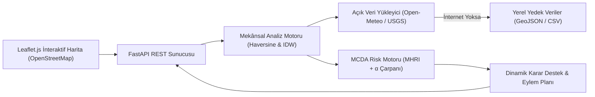

# Afetin İzinde

[](https://doi.org/10.5281/zenodo.24514467)
[](https://orcid.org/0009-0005-6710-3009)
[](LICENSE)

**Afetin İzinde**, ücretli harici API anahtarı gerektirmeyen, açık kaynaklı ve yüksek performanslı bir **Çoklu Afet Risk Analizi ve Mekânsal Karar Destek Yazılım Sistemi**dir.

## Mimari Genel Bakış



## Matematiksel Model (MCDA)

Seçilen bir koordinat veya grid hücresi $i$ için 5 temel parametre $[0.0, 1.0]$ aralığında normalize edilir:

1. **$S_p$ (Seismic Proximity):** Aktif fay hatlarına yakınlık ve tarihsel PGA ($w = 0.30$)
2. **$G_s$ (Geotechnical Stability):** Zemin sınıfı ve sıvılaşma potansiyeli ($w = 0.25$)
3. **$T_e$ (Topographical Relief):** DEM eğim türevleri ve heyelan olasılığı ($w = 0.15$)
4. **$H_m$ (Hydro-Meteorological Load):** Havza drenaj yoğunluğu ve 7 günlük yağış yükü ($w = 0.15$)
5. **$E_d$ (Structural Exposure):** Yapı yoğunluğu ve bina stok yaşı ($w = 0.15$)

### Bileşik Çoklu Afet Risk İndeksi ($MHRI_i$)

$$
MHRI_i = \text{clamp}\left(\alpha \cdot \sum_{k=1}^{5} w_k \cdot x_{i,k},\ 0.0,\ 1.0\right)
$$

* **Zincirleme Etkileşim Çarpanı ($\alpha$):** İki veya daha fazla parametre $\ge 0.70$ eşik değerine ulaştığında $\alpha \in [1.05, 1.15]$ uygulanır; aksi halde $\alpha = 1.0$.

| MHRI Aralığı | Risk Seviyesi (EN) | Risk Seviyesi (TR) |
| :---: | :--- | :--- |
| `0.00 - 0.25` | Low Risk | Düşük Risk |
| `0.26 - 0.50` | Moderate Risk | Orta Risk |
| `0.51 - 0.75` | High Risk | Yüksek Risk |
| `0.76 - 1.00` | Critical Risk | Kritik Risk |

## Kurulum ve Çalıştırma

```bash
git clone https://github.com/Kenan0z/Afetin-Izinde.git
cd Afetin-Izinde
pip install -r requirements.txt
```

### Sunucuyu Başlatma

```bash
uvicorn app.main:app --reload --host 127.0.0.1 --port 8000
```

Tarayıcınızda `http://127.0.0.1:8000` adresini açarak harita üzerinden herhangi bir koordinatı veya hazır Türkiye şehirlerini analiz edebilirsiniz.

### Birim ve Entegrasyon Testleri

```bash
pytest -v tests/
```

## Atıf (Citation)

Polat, K. (2026). *Afetin İzinde: A Multi-Hazard Disaster Risk Analysis and Decision Support Software System*. Zenodo. https://doi.org/10.5281/zenodo.24514467
